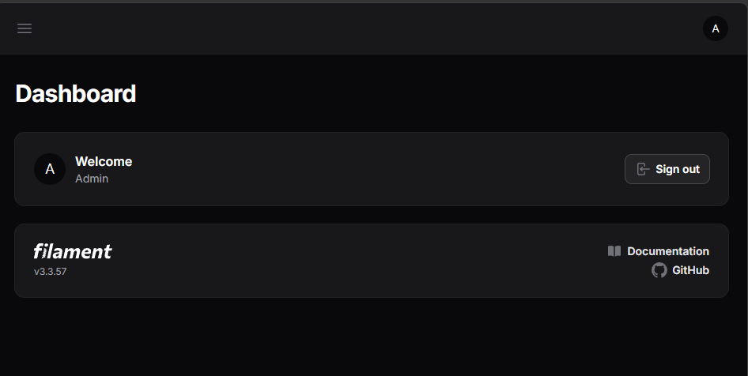
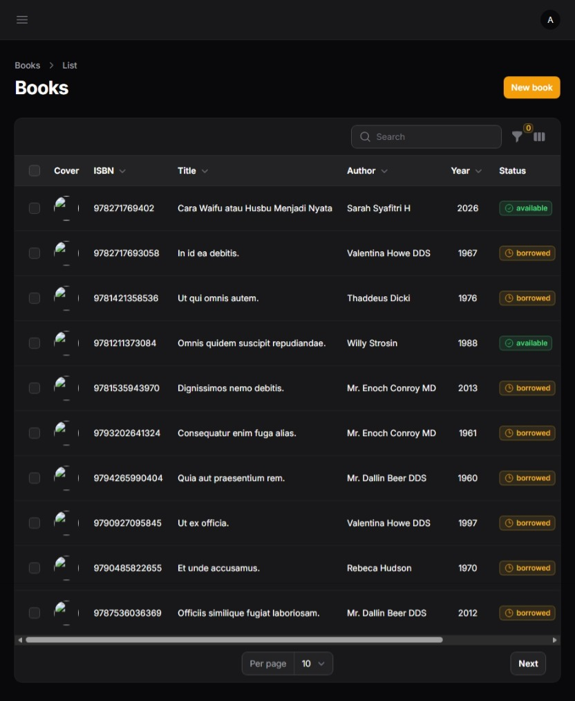
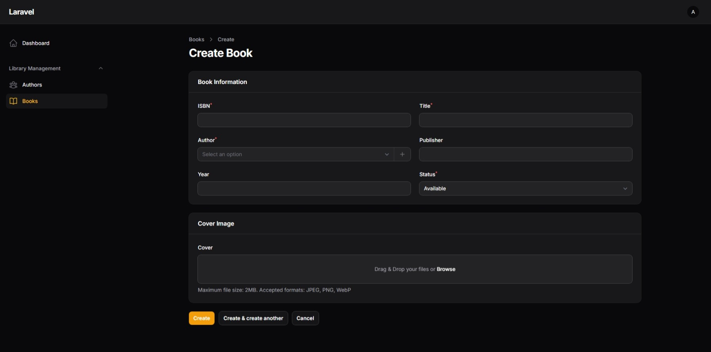
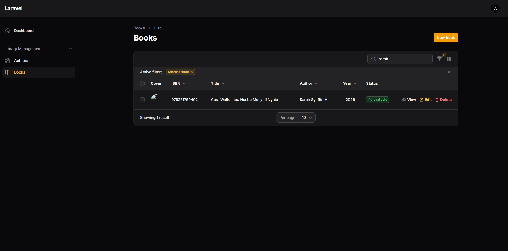
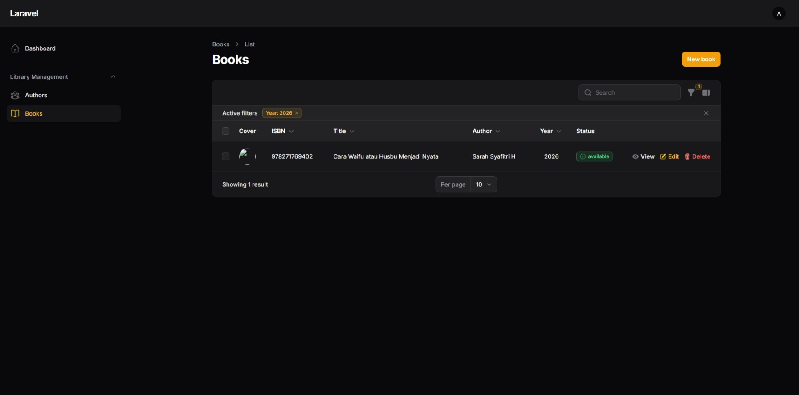
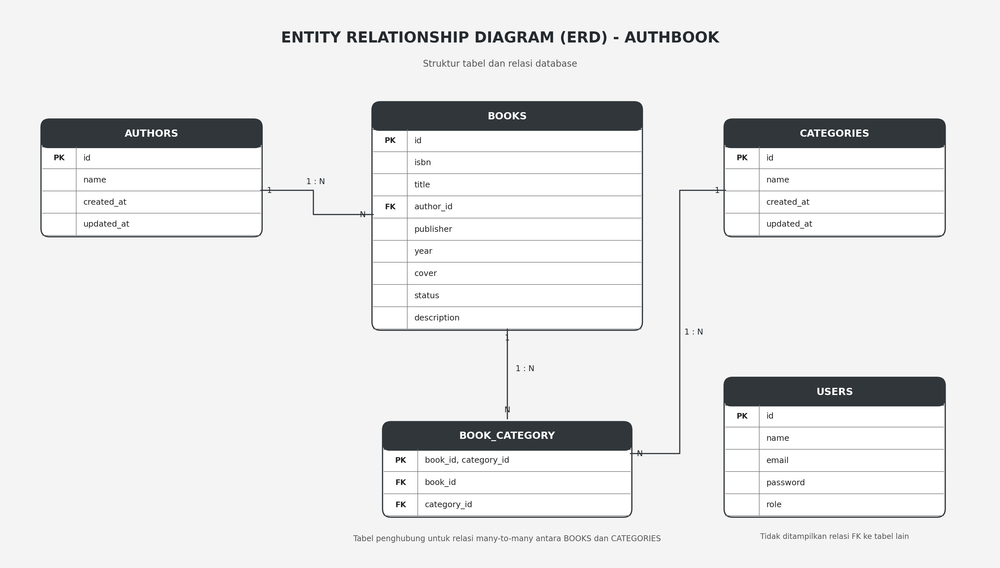

# AuthBook — Praktikum Laravel & Filament 3.3

**Nama:** Sarah Syafitri Hilmi  
**NPM:** 4524210096

## 1. Deskripsi

AuthBook merupakan proyek praktikum pengembangan aplikasi web menggunakan Laravel dan Filament 3.3. Proyek ini mencakup pengelolaan data buku dan penulis, database, autentikasi admin, serta pengaturan hak akses menggunakan Policies.

## 2. Persiapan Instalasi

Pastikan perangkat telah memiliki PHP, Composer, dan database SQLite.

Periksa versi PHP dan Composer:

```bash
php -v
composer -V
```

## 3. Setup Project Laravel

Buat proyek Laravel:

```bash
composer create-project laravel/laravel authbook
```

Masuk ke direktori proyek:

```bash
cd authbook
```

Jalankan server Laravel:

```bash
php artisan serve
```

Akses aplikasi melalui:

```text
http://127.0.0.1:8000
```

### Konfigurasi Database

Atur konfigurasi database pada file `.env`:

```env
DB_CONNECTION=sqlite
```

Pastikan file `database/database.sqlite` tersedia. Jika belum ada, buat file tersebut terlebih dahulu.

Jalankan migration:

```bash
php artisan migrate
```

## 4. Model dan Database

Buat model Author dan Book beserta migration:

```bash
php artisan make:model Author -m
php artisan make:model Book -m
```

Migration digunakan untuk menentukan struktur tabel, sedangkan model digunakan untuk berinteraksi dengan data.

Setelah migration selesai dikonfigurasi, jalankan:

```bash
php artisan migrate
```

## 5. Factory dan Seeder

Buat factory untuk menghasilkan data dummy:

```bash
php artisan make:factory AuthorFactory
php artisan make:factory BookFactory
```

Buat seeder untuk memasukkan data awal:

```bash
php artisan make:seeder AuthorSeeder
php artisan make:seeder BookSeeder
```

Jalankan seeder:

```bash
php artisan db:seed
```

Untuk menjalankan ulang seluruh migration dan seeder:

```bash
php artisan migrate:fresh --seed
```

**Catatan:** Perintah `migrate:fresh` menghapus seluruh tabel sebelum membuatnya kembali.

## 6. Filament Resources

Instal Filament:

```bash
composer require filament/filament:"^3.0"
```

Instal panel admin Filament:

```bash
php artisan filament:install --panels
```

Buat resource Author:

```bash
php artisan make:filament-resource Author
```

Buat resource Book:

```bash
php artisan make:filament-resource Book --generate --view
```

Filament Resource digunakan untuk mengelola data melalui panel admin, seperti melihat, menambahkan, mengubah, dan menghapus data sesuai konfigurasi aplikasi.

## 7. Authorization dengan Policies

Buat policy untuk model Author dan Book:

```bash
php artisan make:policy AuthorPolicy --model=Author
php artisan make:policy BookPolicy --model=Book
```

Contoh metode policy untuk mengatur izin akses:

```php
public function viewAny(User $user): bool
{
    return true;
}
```

Policy dapat digunakan untuk mengatur izin melihat, membuat, mengubah, dan menghapus data. Sesuaikan aturan akses dengan kebutuhan aplikasi.

## 8. Admin User dan Testing

Buat akun admin Filament:

```bash
php artisan make:filament-user
```

Masukkan nama, email, dan password sesuai instruksi terminal.

Jalankan aplikasi:

```bash
php artisan serve
```

Buka panel admin:

```text
http://127.0.0.1:8000/admin
```

Lakukan pengujian login dan fitur pengelolaan data buku serta penulis.

## 9. Verification and Optimization

Periksa daftar route aplikasi:

```bash
php artisan route:list
```

Periksa informasi database:

```bash
php artisan db:show
```

Bersihkan cache aplikasi:

```bash
php artisan optimize:clear
```

Pastikan panel admin dapat diakses dan fitur pengelolaan data berjalan sesuai konfigurasi.

## 10. Tugas 1 — Implementasi Dasar

Bagian ini berisi dokumentasi hasil implementasi dan bukti pengerjaan tugas praktikum.

### A. Login Admin Berhasil

Menampilkan halaman panel admin setelah berhasil login.



### B. Daftar Buku

Menampilkan daftar buku yang tersedia di dalam aplikasi.



### C. Form Tambah Buku

Menampilkan form untuk menambahkan data buku baru.



### D. Hasil Pencarian

Menampilkan hasil pencarian buku berdasarkan kata kunci.



### E. Active Filter

Menampilkan penerapan filter pada daftar buku.



## 11. Tugas3 — Penjelasan Arsitektur

### A. Deskripsi Arsitektur Aplikasi

AuthBook menggunakan framework Laravel dengan pola MVC (*Model-View-Controller*) dan Filament 3.3 sebagai panel administrasi.

Arsitektur aplikasi terdiri dari beberapa bagian:

1. **Model:** Mengelola data dan hubungan antar tabel menggunakan Eloquent ORM.
2. **View:** Menampilkan antarmuka aplikasi kepada pengguna.
3. **Controller dan Routing:** Mengatur proses request dan menentukan respons aplikasi.
4. **Filament Resource:** Mengelola tampilan administrasi, formulir, tabel, dan operasi CRUD.
5. **Database:** Menyimpan data aplikasi menggunakan SQLite.
6. **Authentication:** Memastikan identitas pengguna melalui proses login.
7. **Authorization:** Mengatur izin pengguna melalui Policies.

### B. Entity Relationship Diagram (ERD)

ERD (*Entity Relationship Diagram*) merupakan diagram yang digunakan untuk menggambarkan struktur database dan hubungan antar tabel dalam aplikasi.



**Keterangan:**

- **PK (Primary Key):** Kolom yang menjadi identitas unik setiap data.
- **FK (Foreign Key):** Kolom yang menghubungkan suatu tabel dengan tabel lainnya.
- **1:N:** Relasi one-to-many, yaitu satu data dapat berhubungan dengan banyak data lainnya.
- **M:N:** Relasi many-to-many, yaitu banyak data dapat berhubungan dengan banyak data lainnya.

### C. Penjelasan Tabel Database

Berdasarkan diagram ERD, struktur database AuthBook terdiri dari beberapa tabel berikut.

**1. Tabel Authors**

Tabel `authors` digunakan untuk menyimpan informasi penulis buku.

| Kolom | Keterangan |
|---|---|
| id | Primary Key |
| name | Nama penulis |
| created_at | Waktu data dibuat |
| updated_at | Waktu data diperbarui |

**2. Tabel Books**

Tabel `books` digunakan untuk menyimpan informasi buku.

| Kolom | Keterangan |
|---|---|
| id | Primary Key |
| isbn | Nomor ISBN buku |
| title | Judul buku |
| author_id | Foreign Key yang mengarah ke tabel authors |
| publisher | Nama penerbit |
| year | Tahun terbit |
| cover | Lokasi atau nama file sampul buku |
| status | Status buku |
| description | Deskripsi buku |

**3. Tabel Categories**

Tabel `categories` digunakan untuk menyimpan kategori buku.

| Kolom | Keterangan |
|---|---|
| id | Primary Key |
| name | Nama kategori |
| created_at | Waktu data dibuat |
| updated_at | Waktu data diperbarui |

**4. Tabel Book_Category**

Tabel `book_category` merupakan tabel penghubung antara tabel `books` dan `categories`.

| Kolom | Keterangan |
|---|---|
| book_id | Foreign Key yang mengarah ke tabel books |
| category_id | Foreign Key yang mengarah ke tabel categories |

Tabel ini digunakan untuk menerapkan relasi many-to-many antara buku dan kategori.

**5. Tabel Users**

Tabel `users` digunakan untuk menyimpan informasi akun pengguna aplikasi.

| Kolom | Keterangan |
|---|---|
| id | Primary Key |
| name | Nama pengguna |
| email | Email pengguna |
| password | Password pengguna yang telah di-hash |
| role | Peran atau hak akses pengguna |

### D. Penjelasan Relasi Antar Tabel

Relasi antar tabel dalam aplikasi AuthBook adalah sebagai berikut:

1. **Authors dan Books (One-to-Many)**

   Satu penulis dapat memiliki banyak buku, sedangkan satu buku hanya memiliki satu penulis. Relasi ini menggunakan kolom `author_id` pada tabel `books`.

2. **Books dan Categories (Many-to-Many)**

   Satu buku dapat memiliki beberapa kategori dan satu kategori dapat digunakan oleh banyak buku. Relasi ini menggunakan tabel penghubung `book_category`.

3. **Books dan Book_Category (One-to-Many)**

   Satu buku dapat memiliki beberapa baris data pada tabel penghubung `book_category`.

4. **Categories dan Book_Category (One-to-Many)**

   Satu kategori dapat terhubung dengan beberapa baris data pada tabel penghubung `book_category`.

5. **Users**

   Tabel `users` menyimpan informasi akun pengguna. Pada diagram ini tidak ditampilkan relasi foreign key langsung antara tabel `users` dengan tabel lainnya.

### E. Implementasi Relasi Menggunakan Eloquent ORM

Laravel menyediakan Eloquent ORM untuk mendefinisikan hubungan antar tabel melalui model.

Contoh relasi pada model `Author`:

```php
public function books()
{
    return $this->hasMany(Book::class);
}
```

Relasi tersebut menunjukkan bahwa satu penulis dapat memiliki banyak buku.

Contoh relasi pada model `Book`:

```php
public function author()
{
    return $this->belongsTo(Author::class);
}

public function categories()
{
    return $this->belongsToMany(Category::class);
}
```

Contoh relasi pada model `Category`:

```php
public function books()
{
    return $this->belongsToMany(Book::class);
}
```

Dengan menggunakan Eloquent ORM, pengelolaan hubungan antar tabel menjadi lebih sederhana karena Laravel menyediakan fungsi relasi tanpa harus menuliskan query SQL secara manual untuk setiap operasi.

### F. Implementasi Authentication dan Authorization

Aplikasi AuthBook menerapkan authentication dan authorization untuk mengatur akses pengguna.

**Authentication** digunakan untuk memastikan identitas pengguna melalui proses login.

**Authorization** digunakan untuk menentukan tindakan yang dapat dilakukan pengguna berdasarkan hak aksesnya.

Pengaturan authorization dilakukan menggunakan Policy pada Laravel. Policy dapat mengatur izin untuk beberapa tindakan, seperti:

| Metode Policy | Fungsi |
|---|---|
| viewAny | Mengatur izin melihat daftar data |
| view | Mengatur izin melihat detail data |
| create | Mengatur izin menambahkan data |
| update | Mengatur izin mengubah data |
| delete | Mengatur izin menghapus data |

Dengan adanya Policy, akses terhadap fitur aplikasi dapat dikontrol sesuai aturan yang telah ditentukan.

### G. Alur Kerja Aplikasi dari Request hingga Response

Alur kerja aplikasi AuthBook dimulai ketika pengguna mengakses halaman aplikasi melalui browser.

1. **User Request**

   Pengguna mengakses halaman administrasi melalui browser, misalnya `/admin`.

2. **Routing**

   Laravel menerima request dan mengarahkannya ke halaman atau resource yang sesuai.

3. **Authentication**

   Sistem memeriksa apakah pengguna sudah login. Jika belum, pengguna akan diarahkan ke halaman login.

4. **Authorization**

   Sistem memeriksa hak akses pengguna menggunakan Policy sebelum tindakan tertentu dijalankan.

5. **Filament Resource**

   Filament mengelola tampilan tabel, formulir, pencarian, filter, serta operasi CRUD berdasarkan resource yang digunakan.

6. **Eloquent ORM dan Database**

   Model Eloquent menjalankan operasi terhadap database SQLite, seperti mengambil, menambahkan, mengubah, atau menghapus data.

7. **Response**

   Laravel mengirimkan hasil pemrosesan kembali ke browser. Filament kemudian menampilkan data atau notifikasi kepada pengguna.

Dengan alur tersebut, proses pengelolaan data dapat dilakukan melalui antarmuka administrasi tanpa harus menulis seluruh proses CRUD secara manual.

## 12. Tugas 3 — Perbandingan CRUD Filament dan Manual

Dalam pengembangan aplikasi web, operasi CRUD dapat dibuat menggunakan pendekatan manual maupun menggunakan bantuan library seperti Filament.

### A. Perbandingan CRUD Filament dan Manual

| Aspek | CRUD Filament | CRUD Manual |
|---|---|---|
| Pembuatan tampilan | Menggunakan komponen yang sudah tersedia | Membuat tampilan sendiri menggunakan Blade, HTML, CSS, dan JavaScript |
| Routing | Banyak proses ditangani oleh Filament | Mengatur route secara manual |
| Form | Menggunakan komponen form Filament | Membuat input dan validasi sendiri |
| Tabel data | Menggunakan komponen tabel Filament | Membuat tabel dan query sendiri |
| Validasi | Mendukung aturan validasi Laravel | Menentukan validasi secara manual |
| Hak akses | Dapat diintegrasikan dengan Policy | Mengatur middleware, Policy, dan pengecekan akses sendiri |
| Waktu pengembangan | Relatif lebih cepat | Membutuhkan waktu lebih lama |

### B. Kelebihan CRUD Menggunakan Filament

1. **Pengembangan lebih cepat**

   Filament menyediakan komponen siap pakai sehingga pengembang tidak perlu membuat seluruh tampilan administrasi dari awal.

2. **Tampilan konsisten**

   Komponen tabel, form, tombol, dan navigasi memiliki desain yang konsisten.

3. **Fitur CRUD tersedia**

   Operasi tambah, lihat, ubah, dan hapus data dapat dibuat melalui konfigurasi Resource.

4. **Mendukung validasi**

   Filament dapat menggunakan aturan validasi Laravel untuk memastikan data yang dimasukkan sesuai ketentuan.

5. **Integrasi dengan Laravel**

   Filament dapat menggunakan Eloquent ORM, Authentication, Authorization, dan fitur Laravel lainnya.

### C. Kekurangan CRUD Menggunakan Filament

1. Pengembang harus mempelajari struktur dan cara kerja Filament.
2. Kustomisasi tampilan yang sangat spesifik dapat membutuhkan konfigurasi tambahan.
3. Pengembang menjadi bergantung pada library pihak ketiga.
4. Jika terjadi perubahan versi, beberapa konfigurasi atau komponen mungkin perlu disesuaikan.
5. Proses yang terlalu bergantung pada Filament dapat membuat pengembang kurang memahami proses CRUD secara manual.

### D. Kelebihan CRUD Manual

1. Pengembang memiliki kontrol penuh terhadap tampilan dan alur aplikasi.
2. Struktur kode dapat disesuaikan dengan kebutuhan proyek.
3. Pengembang memahami proses routing, controller, model, query, dan view secara lebih mendalam.
4. Tidak terlalu bergantung pada library administrasi tertentu.
5. Cocok untuk aplikasi yang memiliki kebutuhan antarmuka dan proses bisnis khusus.

### E. Kekurangan CRUD Manual

1. Membutuhkan waktu pengembangan lebih lama.
2. Pengembang harus membuat tampilan dan komponen sendiri.
3. Validasi dan hak akses perlu diatur secara lebih terperinci.
4. Kode dapat menjadi lebih panjang karena banyak proses harus ditulis secara manual.
5. Pemeliharaan aplikasi dapat menjadi lebih rumit jika struktur kode tidak dirancang dengan baik.

### F. Kapan Sebaiknya Menggunakan Filament?

Filament cocok digunakan ketika:

1. Membutuhkan panel administrasi dengan cepat.
2. Aplikasi memiliki kebutuhan CRUD standar.
3. Ingin membuat dashboard pengelolaan data.
4. Ingin memanfaatkan komponen yang sudah disediakan.
5. Waktu pengembangan terbatas.

### G. Kapan Sebaiknya Menggunakan CRUD Manual?

CRUD manual lebih cocok digunakan ketika:

1. Aplikasi memiliki alur bisnis yang sangat khusus.
2. Tampilan antarmuka membutuhkan desain yang bebas.
3. Membutuhkan kontrol penuh terhadap setiap proses.
4. Ingin mempelajari cara kerja Laravel secara lebih mendalam.
5. Fitur yang dibutuhkan tidak sesuai dengan komponen yang tersedia pada Filament.

## 13. Tugas 3 — Refleksi Pembelajaran

### A. Hal yang Dipelajari

Melalui praktikum AuthBook, beberapa hal yang dipelajari adalah:

1. Memahami penggunaan framework Laravel dalam pengembangan aplikasi web.
2. Memahami konsep CRUD untuk mengelola data.
3. Menggunakan Filament 3.3 untuk membuat panel administrasi.
4. Memahami hubungan antar tabel menggunakan ERD.
5. Mengimplementasikan relasi database menggunakan Eloquent ORM.
6. Memahami authentication dan authorization.
7. Mengatur hak akses pengguna menggunakan Policy.
8. Memahami alur request dan response dalam aplikasi Laravel.

### B. Kesulitan yang Dihadapi

Beberapa kesulitan yang dihadapi selama proses pengerjaan adalah:

1. **Memahami struktur Filament**

   Pada awal pengerjaan, struktur folder dan konfigurasi Filament cukup membingungkan karena terdapat beberapa file Resource, Page, dan komponen lainnya.

2. **Mengatur relasi database**

   Menentukan hubungan antara buku, penulis, dan kategori membutuhkan pemahaman mengenai relasi one-to-many dan many-to-many.

3. **Mengatur hak akses pengguna**

   Pengaturan Policy membutuhkan pemahaman mengenai izin akses agar pengguna tidak dapat menjalankan tindakan di luar hak akses yang ditentukan.

4. **Menyesuaikan konfigurasi aplikasi**

   Beberapa konfigurasi perlu disesuaikan agar resource, model, database, dan sistem autentikasi dapat berjalan dengan baik.

### C. Cara Mengatasi Kesulitan

Beberapa langkah yang dilakukan untuk mengatasi kesulitan tersebut adalah:

1. Mempelajari dokumentasi Laravel dan Filament.
2. Memahami fungsi setiap file dan struktur folder secara bertahap.
3. Mempelajari kembali konsep relasi database melalui ERD.
4. Memeriksa konfigurasi model, migration, dan foreign key.
5. Melakukan pengujian terhadap setiap fitur CRUD.
6. Memeriksa konfigurasi Policy agar hak akses berjalan sesuai kebutuhan.

### D. Rencana Pengembangan Selanjutnya

Aplikasi AuthBook masih dapat dikembangkan dengan menambahkan beberapa fitur, seperti:

1. **Fitur peminjaman buku**

   Menambahkan fitur untuk mencatat transaksi peminjaman dan pengembalian buku.

2. **Manajemen stok buku**

   Menambahkan informasi jumlah buku yang tersedia dan jumlah buku yang sedang dipinjam.

3. **Pengembangan sistem pengguna**

   Menambahkan pengaturan role dan hak akses yang lebih fleksibel.

4. **Peningkatan pencarian dan filter**

   Menambahkan fitur pencarian berdasarkan judul, penulis, penerbit, dan kategori buku.

5. **Dashboard statistik**

   Menampilkan informasi jumlah buku, penulis, kategori, serta aktivitas peminjaman.

6. **Pengujian aplikasi**

   Melakukan pengujian lebih lanjut untuk memastikan seluruh fitur berjalan sesuai kebutuhan.

7. **Deployment**

   Mengembangkan aplikasi agar dapat diakses secara online oleh pengguna.

### E. Kesimpulan Pembelajaran

Berdasarkan praktikum yang telah dilakukan, penggunaan Laravel dan Filament 3.3 dapat membantu mempercepat proses pengembangan aplikasi berbasis web, khususnya dalam pembuatan panel administrasi dan pengelolaan data menggunakan CRUD.

Selain mempelajari penggunaan library, praktikum ini juga memberikan pemahaman mengenai struktur database, relasi antar tabel, Eloquent ORM, authentication, dan authorization.

Melalui praktikum ini, dapat disimpulkan bahwa penggunaan library seperti Filament dapat meningkatkan efisiensi pengembangan aplikasi. Namun, pemahaman mengenai proses CRUD secara manual tetap diperlukan agar pengembang dapat memahami cara kerja aplikasi secara menyeluruh.

## 14. Teknologi yang Digunakan

| Teknologi | Kegunaan |
|---|---|
| PHP | Bahasa pemrograman backend |
| Laravel | Framework pengembangan aplikasi web |
| Filament 3.3 | Pembuatan panel administrasi |
| SQLite | Database aplikasi |
| Eloquent ORM | Pengelolaan data dan relasi database |
| HTML dan CSS | Struktur dan tampilan halaman web |

## 15. Repository

Source code aplikasi dapat dilihat melalui repository GitHub berikut:

[GitHub - 4524210096_Sarah_PBW_A](https://github.com/sarhftr/4524210096_Sarah_PBW_A/tree/main/pertemuan6/authbook)

---

**Disusun untuk memenuhi tugas praktikum Pemrograman Berbasis Web.**